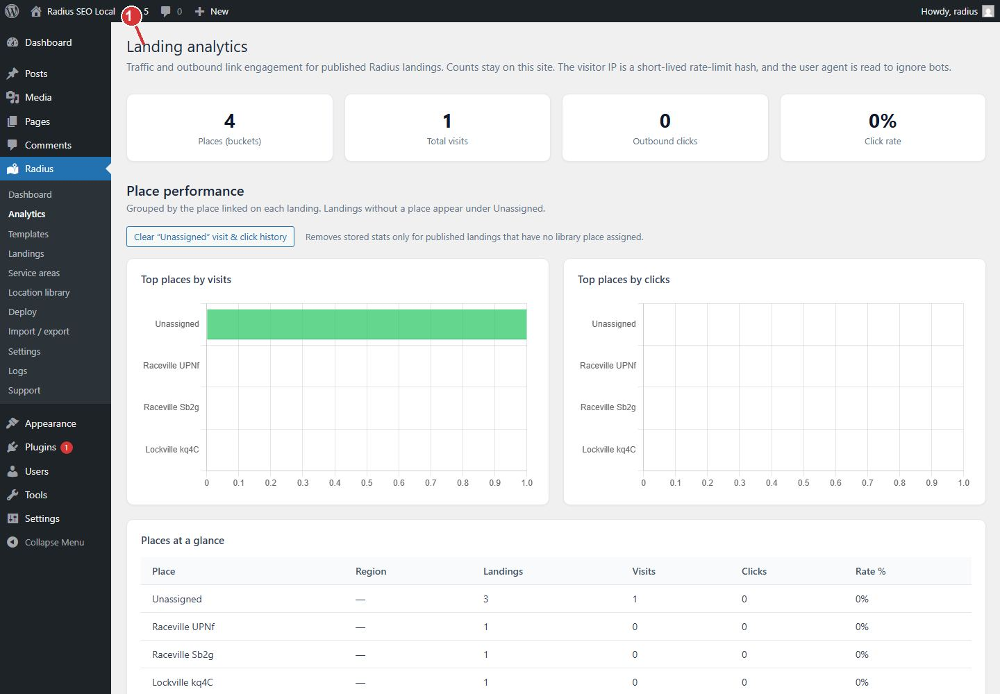

<!-- fragment: analytics -->
<!-- screenshot: analytics.jpg -->

# Analytics

Radius → Analytics counts visits and outbound clicks on published landings. The numbers stay on this site. They are not sent to Duppins Technology.

## Steps

1. Deploy pages first. Analytics is empty until landings exist and someone visits them.
2. Open Radius → Analytics.
3. Read the chart for the shape of the counts. Read the tables when the chart is hard to see, or when you need a place-by-place number.
4. If the load fails, the screen says so in text. It does not leave you with a blank chart and no explanation.

Counts are grouped by place. An outbound click is a click that leaves the landing. The visitor IP is kept only as a short-lived rate-limit hash. The user agent is read so bots can be ignored.

Only an administrator sees this screen.

1. Analytics counts visits and outbound clicks on published landings. The numbers stay on this site.

## Next

If a page is missing from the tables, check [Landings](Landings) and [Deploy](Deploy). The page has to be published before a visit can be counted.
