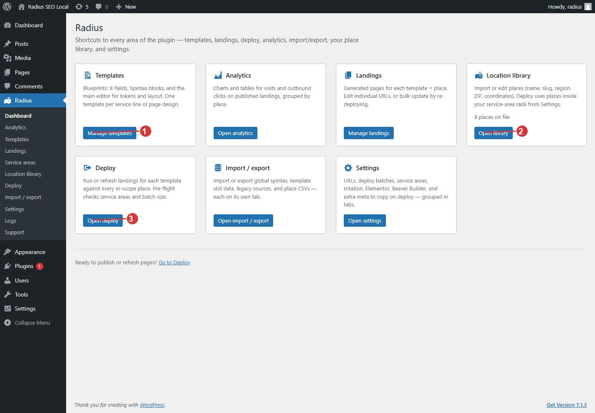

<!-- fragment: dashboard -->
<!-- screenshot: dashboard.jpg -->

# Dashboard

Radius → Dashboard is a set of shortcuts. The cards do not change pages by themselves. Use the button on a card to open that screen.

## What you see

The left menu lists the same destinations: Dashboard, Analytics, Templates, Landings, Service areas, Location library, Deploy, Import / export, Settings, Logs, and Support.

The cards are:

- Templates. Blueprints. One template is usually one service line or page design. Button: Manage templates.
- Analytics. Visits and outbound clicks on published landings. Button: Open analytics. Administrators only.
- Landings. One generated page per template and place. Button: Manage landings.
- Location library. Places, with a count of places on file. Button: Open library.
- Deploy. Run or refresh pages for places inside your service areas. Button: Open deploy.
- Import / export. Spintax, template slots, legacy sources, and place CSVs, each on its own tab. Button: Open import / export.
- Settings. URLs, batches, service areas, rotation, and builders. Button: Open settings. Administrators only.

A line at the bottom says Ready to publish or refresh pages? and links to Deploy. Open Deploy only after a template, a library, and a service-area circle exist.

If the screen says API key required, stop and open License settings. Nothing else on the dashboard will run until a key is saved.

## The usual path from here

1. Manage templates only after you know which service the page is for. If the library is empty, Open library first.
2. Open library and import places. See [Location library](Location-library).
3. Open settings, then the Service areas tab, and draw a circle. See [Service area circles](Settings-service-areas).
4. Manage templates and write the blueprint. See [Template editor](Template-editor).
5. Open deploy. See [Deploy](Deploy).

1. Templates is where you write the blueprint.
2. Location library is where places are imported.
3. Deploy publishes a page for each place after the template is ready.

## Next

[Location library](Location-library).
