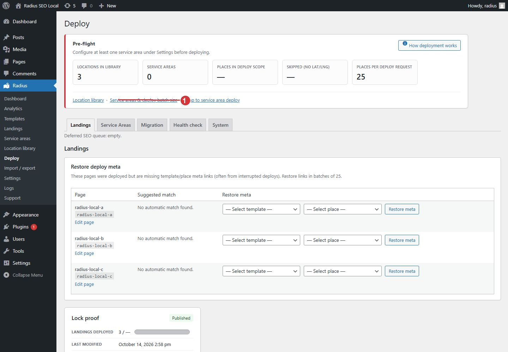
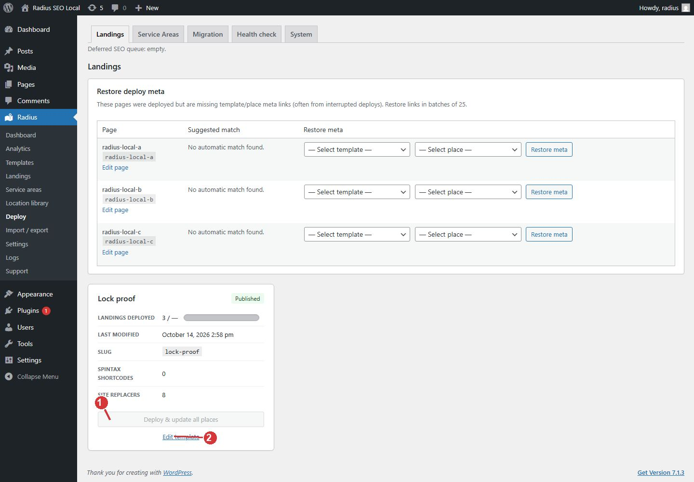

<!-- fragment: deploy -->
<!-- screenshot: deploy.jpg -->
<!-- screenshot: deploy-run.jpg -->

# Deploy

Radius → Deploy publishes or refreshes pages from a finished template. It writes one current landing for each library place inside your service-area circles. Run it again after you edit the template. The same place keeps one page.

Deploy will not run until Settings → Service areas has at least one circle. If the button is grey, that is the reason. Open the service-area settings and add a center place plus a radius in miles. See [Service area circles](Settings-service-areas).

## Before you click deploy

1. The template body and the landing title pattern contain the tokens you want. See [Template editor](Template-editor).
2. Site replacers have the company name and phone. See [Site replacers](Settings-replacers).
3. Places have latitude and longitude.
4. At least one service-area circle is saved.
5. For hubs, Settings → General has a service-area template selected. City landings use the template card on this screen, not that dropdown.

Pre-flight on this screen shows how many places are in the library, how many service areas exist, and how many places are in range. Read it before you start. A library of three places and zero service areas means nothing will be published.

## Run it

1. Open Radius → Deploy.
2. Find the template card.
3. Click Deploy & update all places.
4. Leave the window open. Large libraries run as a chain of requests. Each request stays within the deploy batch size from Settings → General.
5. If a batch stops and JavaScript did not continue, click Continue deployment. Each click runs one batch.
6. If the screen reports a server error, open [Logs](Logs). The processing log is the run. The error log is the failure.

Edit template on the card returns you to the blueprint if the wording is wrong. Fix the template, then deploy again.

Hubs are the Service areas section on this same screen. That section uses the template chosen in Settings → General and publishes under your service-area URL prefix.

Before the first batch, Radius drops places whose slug contains a low-value substring (the same list as Location library → slug cleanup) and collapses duplicate display names so only the shortest slug per name is deployed.

## Health check

Health check reports duplicates and pages that lost their link to a template or a place. It does not publish new pages by itself. Fix all issues is for those reported links. Read the result text before you run it. Reconnect deployed pages, when it is offered, is how a page is pointed back at its template and place.

How deployment works on this screen opens a short explanation. It is the same behavior this article describes.

1. Open Settings, Service areas, and add a center place plus a radius in miles.

1. After the template is ready, Deploy and update all places writes one current landing per place in range. The button stays off while pre-flight says there is no service area.
2. Edit template returns to the blueprint if the pages need different wording.

## Next

[Landings](Landings) for the city pages. [Service area hubs](Service-area-hubs) for the hubs.
