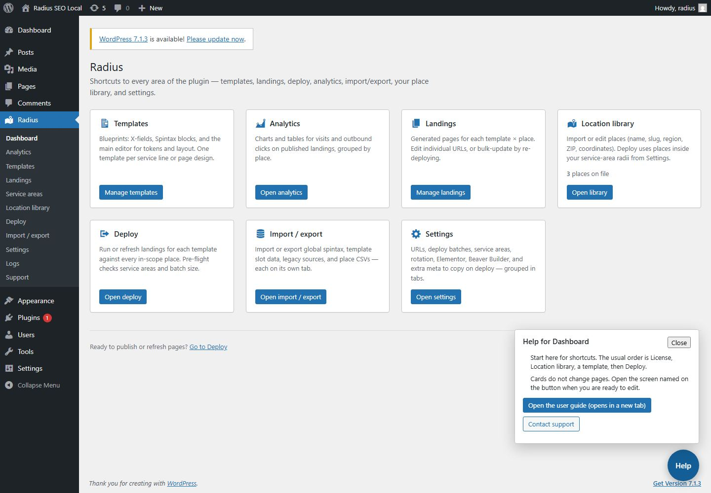

<!-- fragment: help-button -->
<!-- screenshot: help.jpg -->

# Help button

Help is a round button at the bottom-right of every Radius screen. It is not a banner across the top.

## Steps

1. On any Radius screen, click Help.
2. Read the short notes for the screen you are on.
3. Click Open the user guide. It opens this guide in a new tab, at the section for that screen.
4. Administrators also see Contact support. That opens Radius → Support. The Support screen itself does not show Contact support again, because you are already there.
5. Click Close, or press Escape. The panel closes and focus returns to Help.

The notes in the panel are a reminder. This guide is the full walkthrough.

1. Help sits at the bottom-right of every Radius screen. It is not a banner at the top.
2. Open the user guide goes to the guide on duppinstech.com, at the section for the current screen.
3. Contact support opens Radius → Support, for administrators.

## Next

Use the table on [Home](Home) if you arrived here without a section, or continue with [Dashboard](Dashboard).
