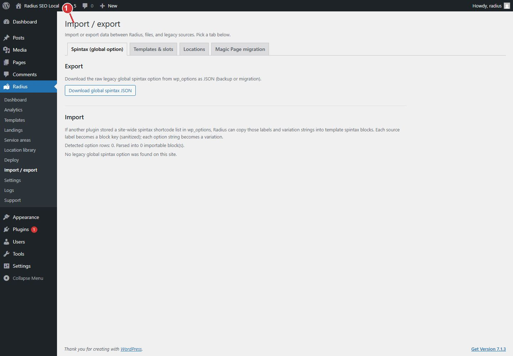

<!-- fragment: import-export -->
<!-- screenshot: import.jpg -->

# Import / export

Radius → Import / export moves pieces in bulk. Day-to-day place import is on [Location library](Location-library). Use this screen when you are filling spintax, template slots, or moving an older Magic Page library.

## Tabs

- Spintax (global option). Upload variation rows that templates can share. If a template is already open in the editor, reload it so the Spintax blocks list picks up the new rows.
- Templates & slots. Fill slot groups on one template. You need permission to edit that template.
- Locations. The same place CSV as the location library. Prefer the library screen when you are only adding cities.
- Magic Page migration. Use this only when this WordPress database still has Magic Page data. Leave it alone on a new site.

## Magic Page migration, only if you are moving an old library

The guided flow copies locations, imports blueprint templates (including Elementor documents), and publishes one Radius template per Magic Page service group. Then you finish spintax and deploy on the other tabs.

1. Read the server readiness score. Migration stays blocked below 60 percent unless you acknowledge the risk and bypass the check.
2. Run the legacy place import in batches. Batch size, skip-existing, and the pause between batches are under Settings → General.
3. Import the blueprint templates and open each draft to confirm the layout.
4. Finish on the Spintax tab, then [Deploy](Deploy).

Pulling places from a remote Magic Page server is not supported. Use a database on this site, or export places and upload the CSV.

1. Import / export holds spintax, template slots, place CSV, and the Magic Page migration. Use migration only when moving an older library.

## Next

[Deploy](Deploy) after the template and the library look right. [Logs](Logs) if a batch reports a server error.
