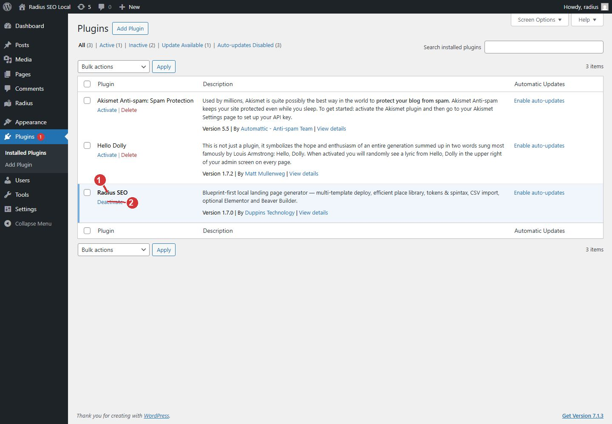

<!-- fragment: install -->
<!-- screenshot: plugins.jpg -->

# Install

Install Radius SEO from the release zip, then activate it. The zip must contain one folder, and that folder must contain `radius.php`.

## Steps

1. In wp-admin open Plugins → Add New → Upload Plugin.
2. Choose `wp-radius-seo.zip` from the GitHub release. Install Now.
3. Activate Radius SEO.
4. The left menu gains a Radius item. Open Radius → Dashboard.

WordPress 6.0 or newer and PHP 7.4 or newer are required.

Until a license key is saved, Radius shows API key required and asks you to open License settings. Templates, landings, deploy, and imports stay locked. Go to [License](License) next.

## Deactivate is not uninstall

On the Plugins row, Deactivate asks whether to keep Radius data or delete it. That choice is covered in [Deactivate](Deactivate). Cancel, Close, Escape, or a click outside the dialog leaves the plugin active and deletes nothing.

1. Radius SEO in the plugin list. This is the installed plugin.
2. Deactivate opens the keep-or-delete choice. Cancel leaves the plugin on.

## Next

[License](License).
