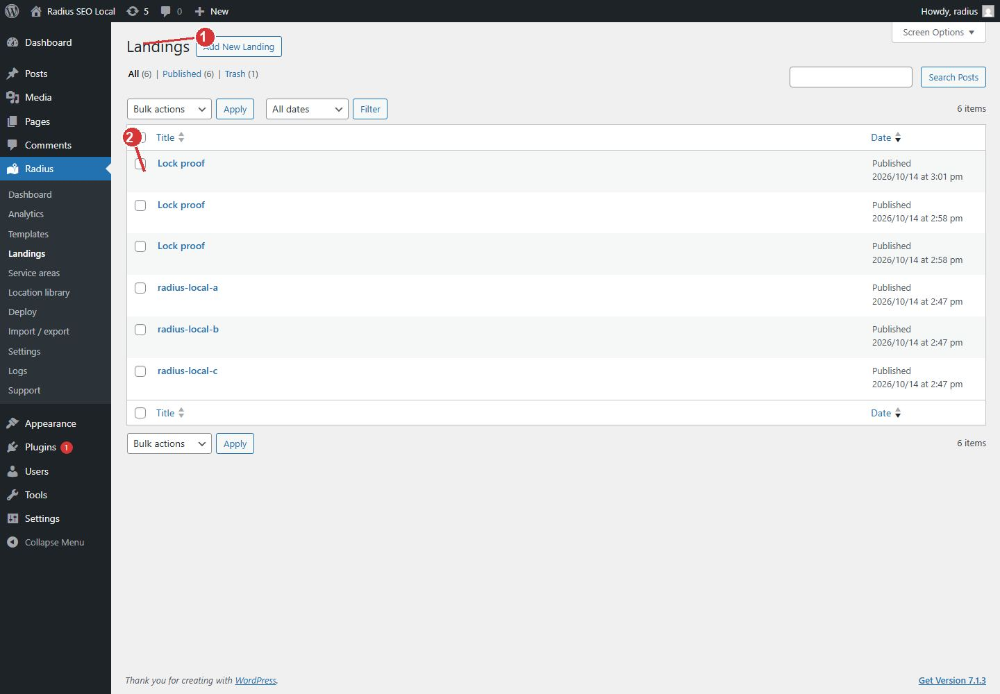

<!-- fragment: landings -->
<!-- screenshot: landings.jpg -->

# Landings

Radius → Landings lists the city pages. Each row is one deployed page for one template and one place. These URLs sit at the site root. They do not use the service-area prefix. Example: `/tire-repair-springfield/`.

Hub pages are a different list. See [Service area hubs](Service-area-hubs).

## Steps

1. Open Radius → Landings after a deploy.
2. Find the place. Open the row to view or edit that page, or click View to see the public URL.
3. To refresh the wording for many cities, do not edit every row. Edit the template, then deploy that template again. Deploy updates the existing page. It does not add a second copy of the same place.
4. A filter or search on this list only changes which rows you see. It does not publish or delete pages.

If a place you imported is missing here, it was outside the service-area circle, it had no latitude and longitude, or its slug was skipped as a low-value match (for example a subdivision). Check [Service area circles](Settings-service-areas) and [Location library](Location-library), then deploy again.

1. Each landing is one deployed page for one template and one place.
2. Deploy again to update these pages. It does not add a second copy of the same place.

## Next

[Edit one landing](Landing-editor) if one page needs a temporary change. [Deploy](Deploy) if the whole set should match the template.
