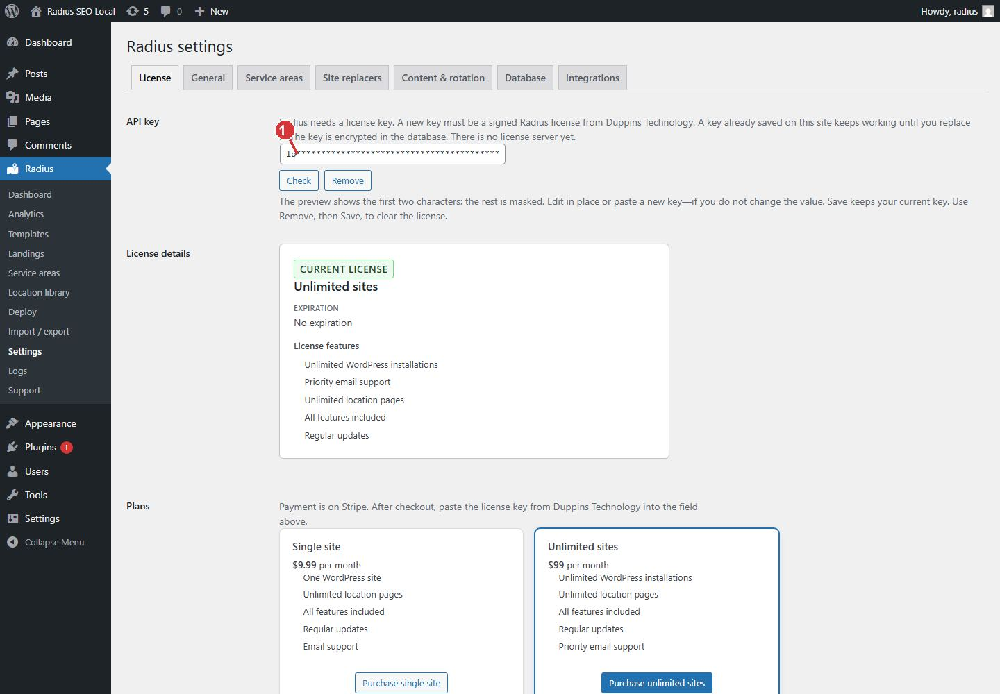

<!-- fragment: license -->
<!-- screenshot: license.jpg -->

# License

Open Radius → Settings → License. Paste a signed key from Duppins Technology, then save it. Check only tells you whether the key is signed. It does not store it.

## Steps

1. Open Radius → Settings. The License tab is the first tab. If no key is saved, other Radius screens send you here.
2. Click in API key. Paste the signed key. A new key starts with `RSL1.`
3. Click Check if you want to confirm the signature before saving. A failed check means the text is not a signed Radius key. It does not erase a key that is already saved.
4. Click Save Changes. The key is encrypted in the database.
5. Open Radius → Dashboard. The lock notice should be gone.

A key already saved on this site keeps working until you replace it or click Remove. There is no license server yet. The plugin cannot see a Stripe cancellation, and it does not refuse a single-site key on a second site. Say that honestly if a customer asks. Priority email for the unlimited plan is flagged in the Duppins Technology account. The plugin does not store or check that flag.

## Purchase

The same screen has two purchase cards. Each opens Stripe in a new tab. After checkout, Duppins Technology sends the key. Paste that key here. The plugin does not receive the payment by itself.

- Single site is $9.99 per month. Purchase single site: https://buy.stripe.com/6oU7sK8Yt9hag4f0iJ00007
- Unlimited sites is $99 per month. Purchase unlimited sites: https://buy.stripe.com/4gM5kCeiN9ha8BN6H700008

Cancelling the Stripe subscription does not yet turn a saved key off.

Remove clears the saved key. After that, templates, the library, and deploy lock again until a key is saved.

1. Paste the signed license here, then Save. Check does not store the key.

The purchase cards are on this same screen, under the key field.

## Next

[Location library](Location-library), unless you still need to [install](Install).
