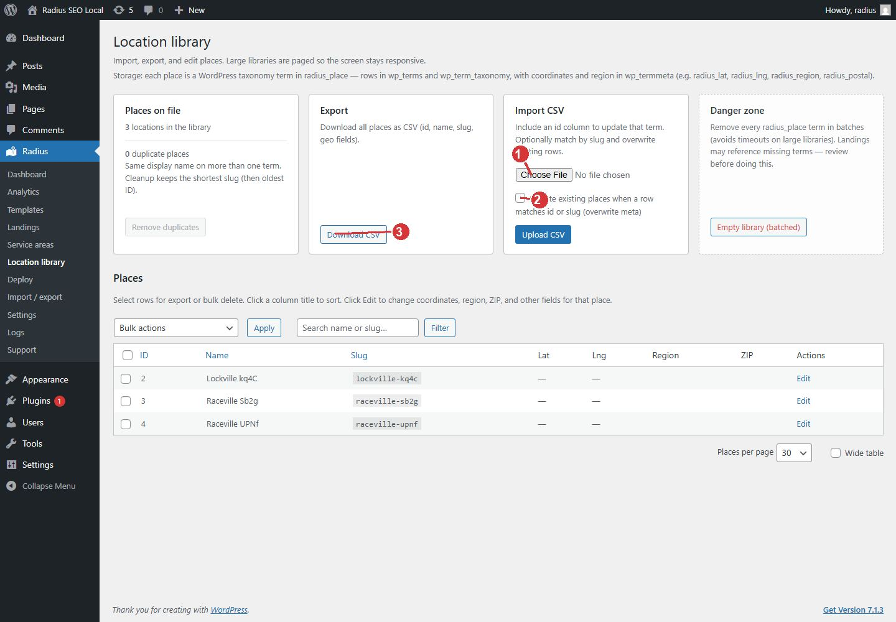

<!-- fragment: location-library -->
<!-- screenshot: locations.jpg -->

# Location library

Radius → Location library is where places live. Radius does not download a city list. You bring the places in a CSV, or you add one place at a time.

A place needs a name. Deploy skips a place that has no latitude and longitude.

## Where the data comes from

Prepare a spreadsheet of the cities you serve. Export it as CSV with a header row. Download CSV on this screen writes a file in the column order Radius expects, which is the easiest template to fill in:

`id, name, slug, country, region, state, zip, lat, lng`

`name` is required. `lat` and `lng` are required if that place should receive a page. The other columns are optional. `id` is used only when you are updating a place that is already in the library.

A valid first file:

```
name,slug,region,state,zip,lat,lng
Springfield,springfield,Virginia,VA,22150,38.7893,-77.1872
```

Coordinates are decimal degrees. Springfield in this example is a sample row, not a place Radius ships for you.

## Upload

1. Open Radius → Location library. Only an administrator can upload.
2. Under Import CSV, choose the file.
3. Leave Update existing places off the first time. Rows that match an id or slug you already imported are skipped.
4. Turn Update existing places on only when you mean to overwrite the name and map fields of a match.
5. Click Upload CSV.
6. The table lists the places. Click Edit on a row to change coordinates, region, ZIP, and the other fields for that place.

Download CSV exports the whole library in that same column order. To export some rows, select them, choose Export selected as CSV, and click Apply.

## Cleanup on this screen

- Remove duplicates keeps the shortest slug when the same display name exists more than once.
- Orphan numbered slugs repairs a slug that ends in -1 through -9 when the base slug is missing. If the base slug already exists, use Remove duplicates for the extra numbered rows.
- Slug pattern matches finds substrings such as trailer, subdivision, or village. Deploy skips those places too. Removing a place here also moves its deployed landing and service-area hub to the Trash.

Empty library (batched) deletes every place. Landings may then point at missing places. Review the list before you use it. This cannot be undone from this screen.

Bulk action Delete selected (cannot undo) deletes only the rows you checked.



1. Upload a CSV with columns name, lat, and lng. A name column is required.
2. Leave this off to skip places you already imported. Turn it on to overwrite matches.
3. Download CSV shows the column order: id, name, slug, country, region, state, zip, lat, lng.

## Next

[Service area circles](Settings-service-areas). A library by itself does not publish pages.
