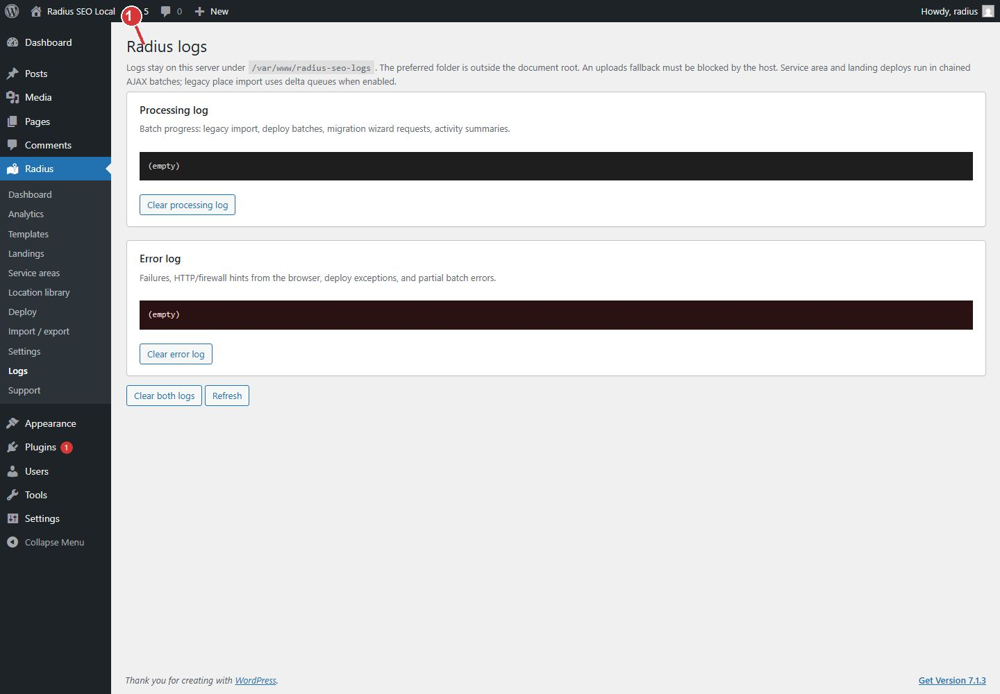

<!-- fragment: logs -->
<!-- screenshot: logs.jpg -->

# Logs

Open Radius → Logs after a deploy or import reports a server error.

## How to read them

- The processing log is the run. It shows how far a batch got.
- The error log is the failure. Copy the message if you contact support.

Logs stay on this site. They are removed only if you confirm Delete all Radius data when deactivating. See [Deactivate](Deactivate).

If the processing log shows a timeout, lower the deploy batch size under [General](Settings-general) and click Continue deployment. If the error names a missing template or place, open [Deploy](Deploy) health check rather than deleting the landing.

1. Open Logs when deploy or import reports a server error. The processing log is the run. The error log is the failure.

## Next

[Support](Support) if the log does not tell you what to change.
