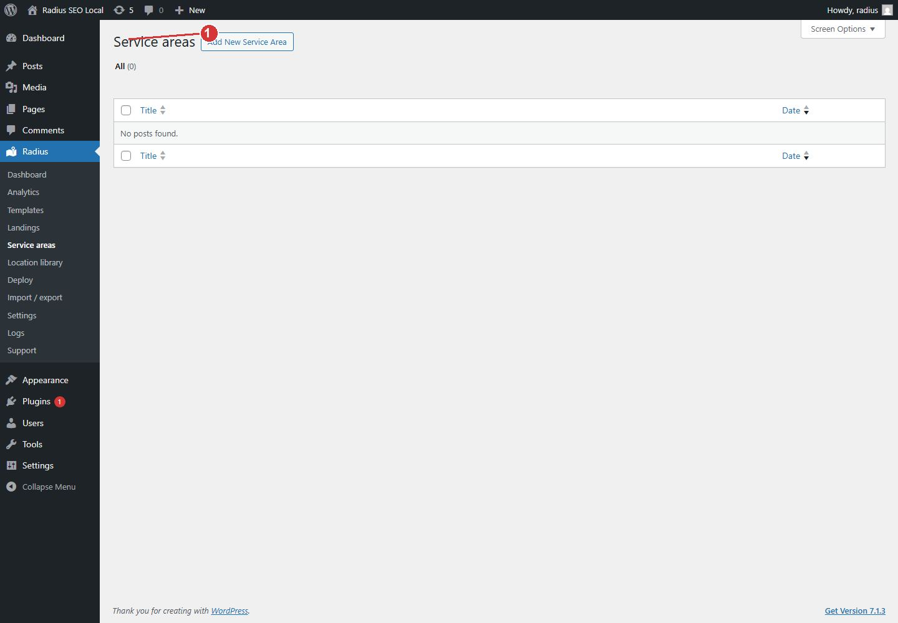

<!-- fragment: service-area-hubs -->
<!-- screenshot: service-areas.jpg -->

# Service area hubs

Radius → Service areas lists hub pages, not the city landings. A hub URL uses the prefix from Settings → General, then the place slug. Example: `/service-area/springfield/`. City landings stay at the site root.

The circles that decide which places are in range are not drawn on this list. Those circles are Settings → Service areas. See [Service area circles](Settings-service-areas).

## Steps

1. Choose a service-area template under Settings → General. Deploy uses that template for hubs and shows it as read-only on the Deploy screen.
2. Open Radius → Deploy, then the Service areas section, and run the hub deploy.
3. Return here. Each row is one hub for one place.
4. To change the wording of every hub, edit that service-area template and deploy the hubs again. The same place keeps one hub.

1. Service areas are hub pages. Their URLs use the prefix from Settings, General.

## Next

[Edit one hub](Service-area-hub), or [Service area circles](Settings-service-areas) if no hubs were created because no circle is saved.
