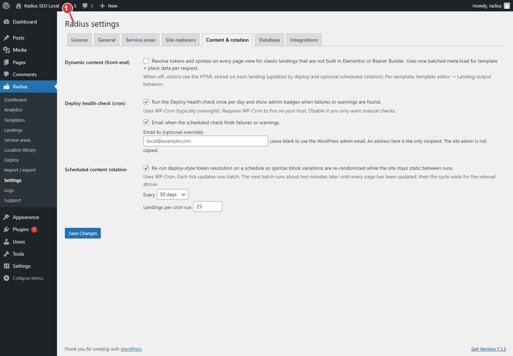

<!-- fragment: settings-content -->
<!-- screenshot: settings-content.jpg -->

# Content and rotation

Open Radius → Settings → Content & rotation. Leave scheduled rotation off unless you want spintax rewritten on a timer.

## What the switches do

- Resolve tokens on every page view applies to classic landings that are not built in Elementor or Beaver Builder. When it is off, visitors see the HTML stored on each landing. That HTML is updated by deploy and, if you turn it on, by scheduled rotation. A template can override this in the template editor under Landing output behavior.
- Scheduled content rotation uses WP-Cron. Each tick updates one batch. The next batch runs about two minutes later until every page has been updated, then the cycle waits for the interval you set. Between runs, visitors see the stored page. Leave this off for a normal site. Deploy already writes the spintax choice onto the page.
- Health email goes to the override address only when you enter one. Otherwise it uses the WordPress admin email.

Click Save Changes.

1. Leave scheduled rotation off unless you want spintax rewritten on a timer.

## Next

[Integrations](Settings-integrations) if the template uses Elementor or Beaver Builder. Otherwise [Deploy](Deploy).
