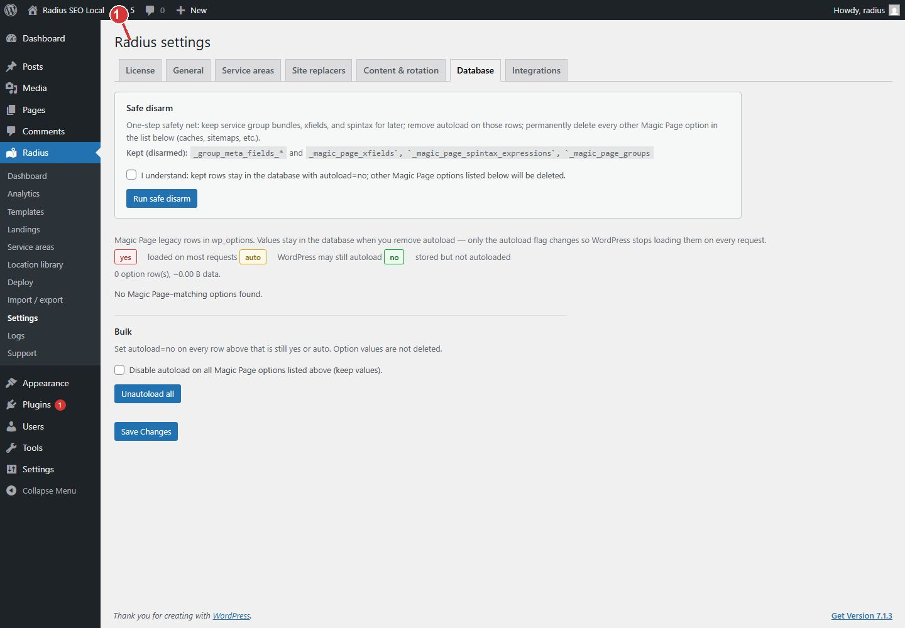

<!-- fragment: settings-database -->
<!-- screenshot: settings-database.jpg -->

# Database

Open Radius → Settings → Database. This tab is for leftover Magic Page options after that plugin is off.

On a new site, do nothing here. Do not delete rows you do not recognize. A row still used by another plugin will not come back from this screen.

If you migrated from Magic Page and the other plugin is deactivated, this is where those leftover options are listed. Read the name before you delete one.

1. Database is for leftover Magic Page options. Leave it alone on a new site.

## Next

[Import / export](Import-export) if a Magic Page library still needs to move. Otherwise leave this tab.
