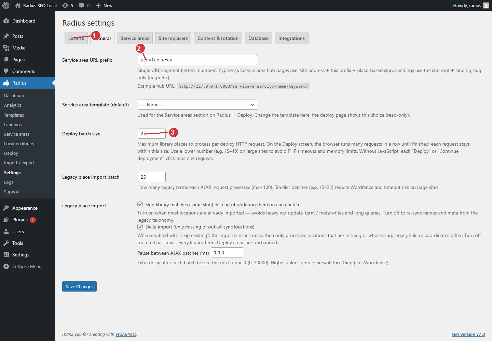

<!-- fragment: settings-general -->
<!-- screenshot: settings-general.jpg -->

# General settings

Open Radius → Settings → General. This tab holds the hub URL prefix, the template Deploy uses for hubs, and the batch sizes. Click Save Changes before you leave the tab.

## Fields

- Service area URL prefix. One segment of letters, numbers, and hyphens. Hub pages use the site address, this prefix, and the place slug. Example: `/service-area/springfield/`. Landings do not use this prefix. They stay at the site root.
- Service area template (default). The blueprint for hubs. Deploy’s Service areas section uses this choice and shows it as read-only. City landings use the template card on the Deploy screen, not this dropdown. Choose None only if you are not publishing hubs.
- Deploy batch size. The maximum number of places in one deploy request. The browser chains those requests until the run finishes. Lower it (about 15 to 40) when a host times out. Without JavaScript, each Deploy or Continue deployment click runs one request. The maximum is 200.
- Legacy place import batch, Skip library matches, Delta import, and Pause between AJAX batches. These apply only to a Magic Page place import. On a new site, leave them. Smaller batches and a longer pause reduce timeouts and firewall throttling. The pause is in milliseconds, from 0 to 30000.

1. Each settings job has its own tab. License, General, Service areas, Site replacers, Content and rotation, Database, Integrations.
2. This prefix is only for hub URLs. Landings stay at the site root.
3. Lower the deploy batch size when a host times out.

## Next

[Service area circles](Settings-service-areas) if you have not drawn one. [Site replacers](Settings-replacers) for the company name and phone.
