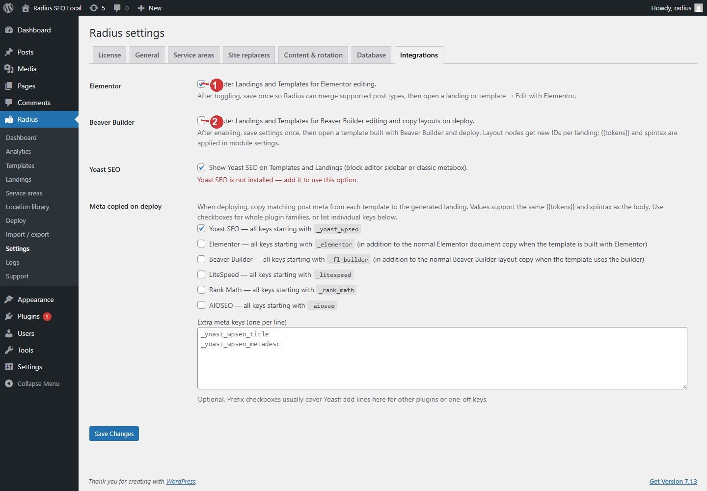

<!-- fragment: settings-integrations -->
<!-- screenshot: settings-integrations.jpg -->

# Integrations

Open Radius → Settings → Integrations. Turn a builder on only when a template was built in that editor. Then save, then deploy.

## Steps

1. Elementor. Check Register Landings and Templates for Elementor editing only if Elementor is installed and the template is an Elementor layout. Save once so Radius can merge the post types. Then open the template and use Edit with Elementor.
2. Beaver Builder. Check the Beaver Builder box only when the template is a Beaver Builder layout. Save, then edit the template in Beaver Builder.
3. Meta copied on deploy sends matching template fields onto each landing. Tokens in those fields are replaced at deploy.
4. Click Save Changes.
5. Deploy the template again. The builder layout is copied onto each landing only when the matching switch was on at deploy time.

A template written in the normal WordPress editor does not need either box. Leaving them on does not convert a block template into an Elementor layout.

1. Turn on Elementor only when a template was built in Elementor. Save, then deploy.
2. Turn on Beaver Builder only when a template was built in Beaver Builder. Save, then deploy.

## Next

[Deploy](Deploy).
