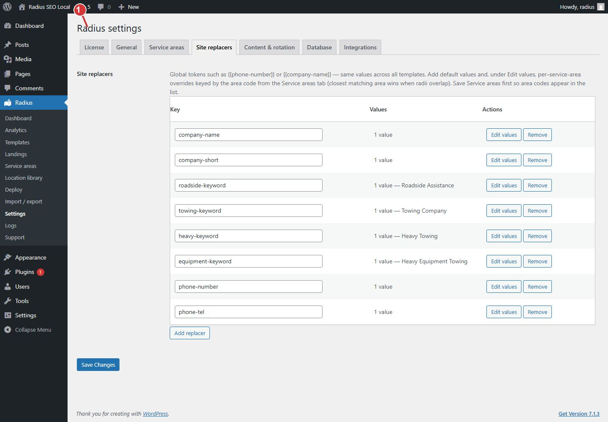

<!-- fragment: settings-replacers -->
<!-- screenshot: settings-replacers.jpg -->

# Site replacers

Open Radius → Settings → Site replacers. A replacer is a token such as `{{company-name}}` or `{{phone-number}}`. The value is written onto every deployed page.

Save Service areas first so area codes appear when you want a different value inside one circle.

## Steps

1. Find the row. The usual keys are `company-name`, `company-short`, `roadside-keyword`, `towing-keyword`, `heavy-keyword`, `equipment-keyword`, `phone-number`, and `phone-tel`.
2. Click Edit values.
3. Enter the default. This is the value used when no area override matches.
4. For a circle that needs a different phone, add an override keyed by that area code (`sa-…`). The closest matching circle wins when radii overlap.
5. Click Save Changes.
6. Deploy again. Existing pages keep the old text until the next deploy.

`phone-number` is the text in the page, and it may be a clickable phone link. `phone-tel` is the dialable number Radius puts in the link address. Use both when the visible number and the `tel:` value should match.

Add replacer creates a new token. The key should be lowercase. Use it in a template as `{{your-key}}`. Remove deletes that token. Pages already deployed still show the old value until you deploy again.

An empty stored list clears the suggested rows. If you remove rows by mistake, add the keys back before you deploy.

1. A replacer fills a token such as {{company-name}} or {{phone-number}} on every deployed page.

## Next

[Deploy](Deploy).
