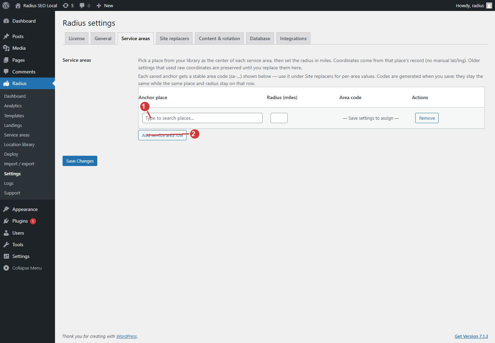

<!-- fragment: settings-service-areas -->
<!-- screenshot: settings-areas.jpg -->

# Service area circles

Open Radius → Settings → Service areas. Each row is a center place from the location library plus a radius in miles. Deploy includes library places that fall inside those circles. Places with no coordinates are skipped.

This tab is not the hub-page list. Hub pages are Radius → Service areas. See [Service area hubs](Service-area-hubs).

## Steps

1. Import places first. The anchor search only finds places that are already in the library.
2. Search for the anchor place. That place is the center of the circle.
3. Enter the radius in miles.
4. Click Add service area row if you serve another region, and repeat.
5. Click Save Changes.

Saving assigns an area code such as `sa-…`. [Site replacers](Settings-replacers) can then store a different phone number, or any other token, for places inside that circle. The closest matching circle wins when two circles overlap. Save the circles before you expect those codes to appear on the replacers screen.

Deploy stays disabled until at least one circle is saved.

1. Anchor place is the center of the circle. Pick it from the location library.
2. Add another circle when you serve more than one region. Save to assign area codes.

The miles field is on the same row as the anchor place. The numbered mark is the Add service area row control.

## Next

[Site replacers](Settings-replacers) if the company name and phone are still empty, then [Deploy](Deploy).
