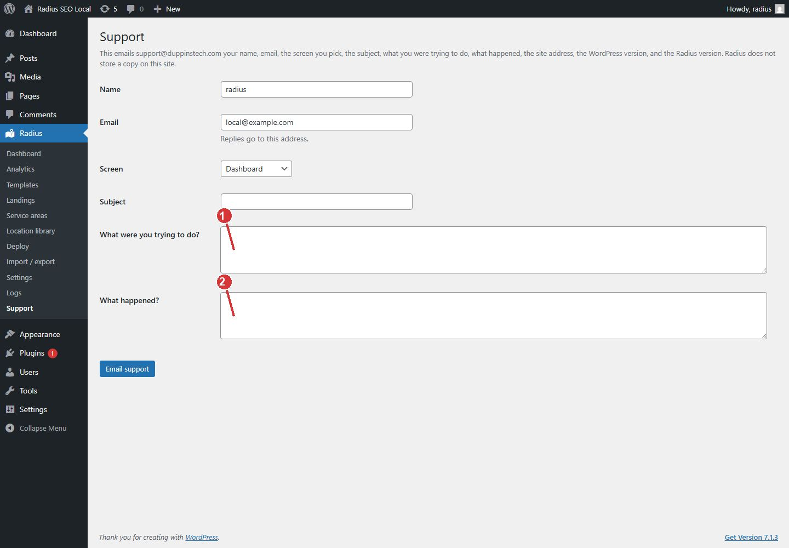

<!-- fragment: support -->
<!-- screenshot: support.jpg -->

# Support

Radius → Support emails Duppins Technology. The message is not stored on the site. Only an administrator can open this screen.

## Steps

1. Open Radius → Support. You can also click Contact support in the Help panel on any other Radius screen.
2. Name and Email are filled from your WordPress user. Replies go to that email.
3. Choose the Screen that matches where you were working.
4. Enter a Subject.
5. What were you trying to do? Name the template or the place when a single page is wrong.
6. What happened? Paste the on-screen error when a batch stops.
7. Click Email support.

The message includes your name, email, the screen, the subject, both descriptions, the site address, the WordPress version, and the Radius version.

Wait a minute before sending another one. If the site cannot send mail, email support@duppinstech.com directly. Call (240) 397-8221.

1. Describe what you were trying to do.
2. Describe what happened. Email support sends this to support@duppinstech.com and does not store a copy.

## Next

[Logs](Logs) if you have not copied the error yet.
