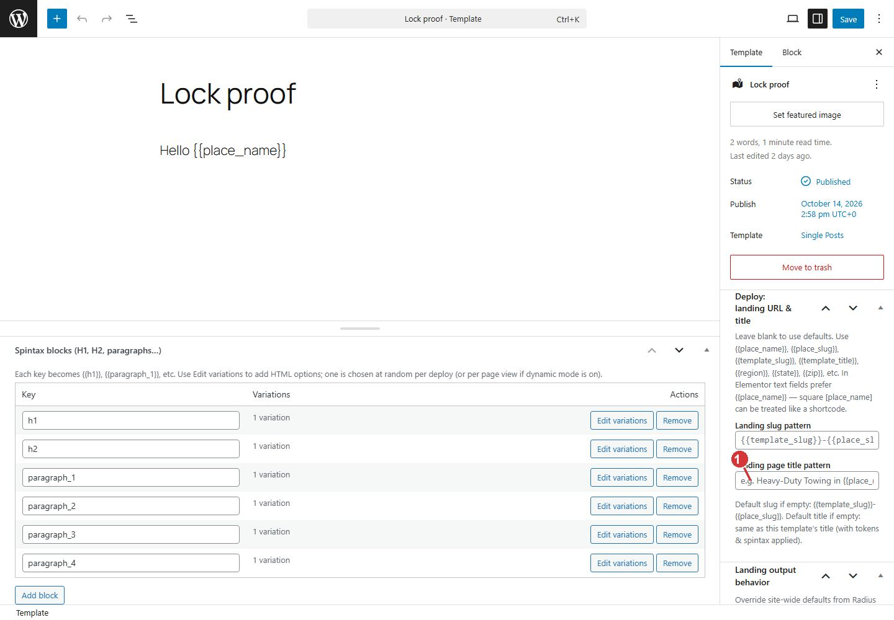

<!-- fragment: template-editor -->
<!-- screenshot: template-edit.jpg -->

# Template editor

Open a template from Radius → Templates. This screen is the page visitors will see after tokens are filled in. Preview is only for people who can edit this template. Visitors do not see the blueprint.

If WordPress shows a welcome dialog over the editor, press Escape until the fields are visible.

## Write the page once

1. Leave the template title as the private name (Tire repair).
2. In the body, write the page with tokens where the place and the company details should change.
3. In the sidebar, set the landing title pattern. Example: `Towing in {{place_name}}`. Deploy fills the place name. This pattern is the public title, not the template title.
4. Set the landing slug pattern if you need a specific URL shape. Landings are published at the site root, for example `/tire-repair-springfield/`.
5. Click Update.

Tokens you can put in the title, the body, and meta fields:

- `{{place_name}}` `{{place_slug}}` `{{country}}` `{{region}}` `{{state}}` `{{zip}}` `{{lat}}` `{{lng}}`
- Site replacers, such as `{{company-name}}` `{{company-short}}` `{{phone-number}}`. The values are set in [Site replacers](Settings-replacers). `{{phone-number}}` may be a phone link. In a web address, Radius uses `{{phone-tel}}` so the link stays valid.
- Spintax: `{fast|quick|same-day}` stores one of those words on that page. It does not rotate on every visit unless you later turn on scheduled rotation.

Spintax blocks in the sidebar are optional extra variation for a heading or a paragraph. Each block has a label and choices. You do not have to use them on the first template.

## Builders

If this template was built in Elementor or Beaver Builder, turn that builder on under [Integrations](Settings-integrations), save, then return here and edit with that builder. Deploy copies the builder layout onto each landing only when that switch is on. A normal block template does not need either switch.

## What deploy will do with this template

Deploy writes one current landing per place in range. Edit this template later, deploy again, and those landings update in place. A hand edit on one landing is replaced the next time that template and place are deployed. See [Edit one landing](Landing-editor).

1. Landing title pattern. Example: Towing in {{place_name}}. Deploy fills the place name.

The body above that sidebar is where `{{place_name}}` and the other tokens go.

## Next

If places and a service-area circle are saved, go to [Deploy](Deploy). If the company name and phone are still empty, set [Site replacers](Settings-replacers) first.
