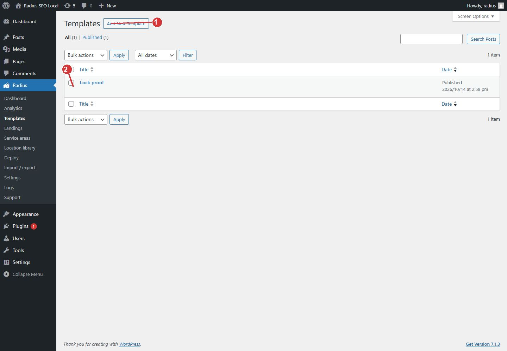

<!-- fragment: templates -->
<!-- screenshot: templates.jpg -->

# Templates

A template is the blueprint. Visitors never see this list. Deploy copies the blueprint once for each place inside your service-area circles.

One template is usually one service line or one page design. A towing page and a tire-repair page are two templates.

## Steps

1. Open Radius → Templates.
2. Click Add New Template.
3. Name the template for yourself, for example Tire repair. That title is the name in wp-admin. The public title is set in the editor as the landing title pattern. See [Template editor](Template-editor).
4. Write the body once, with tokens, and update the template.
5. When the wording is right, go to [Deploy](Deploy). Do not write a separate WordPress page for every city.

Each row is one blueprint. Open the row title to edit it. The row checkbox is for WordPress bulk actions on this list. It does not deploy.

1. Add New Template starts a blueprint. One template is usually one service.
2. Each row is a blueprint. Open it to put tokens in the title and body, then deploy it.

## Next

[Template editor](Template-editor).
